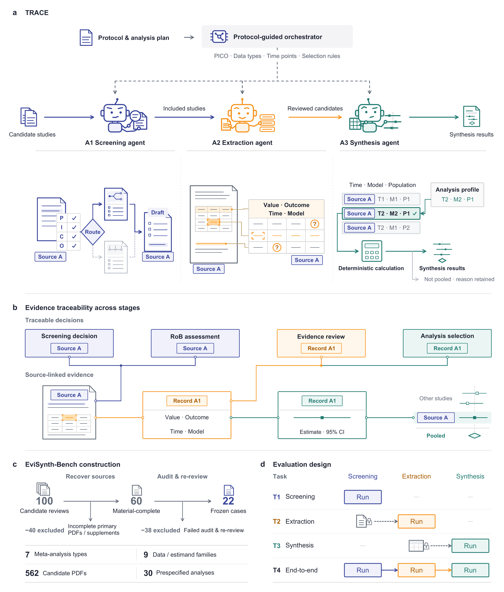
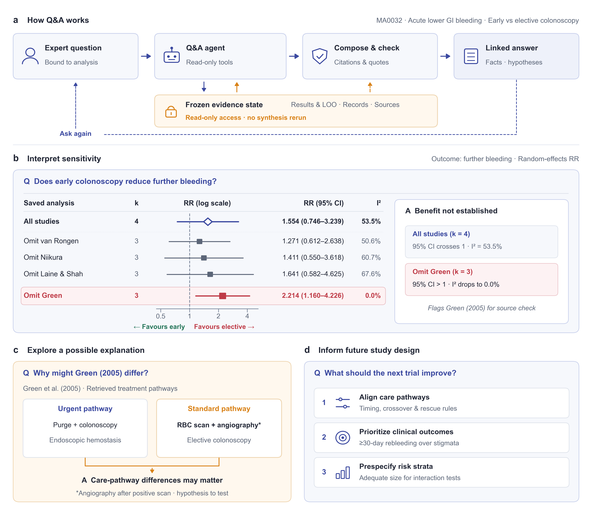

# TRACE

**Traceable, reviewable, agentic and cross-stage evidence synthesis for medical meta-analysis**

[Quickstart](QUICKSTART.md) · [CLI Guide](docs/CLI.md) · [Input Contract](docs/INPUTS.md) · [Literature Retrieval](docs/RETRIEVAL.md) · [Statistical Interfaces](docs/statistical_method_policy.md) · [Incremental Updates](docs/UPDATE_COMPATIBILITY.md) · [Architecture](docs/ARCHITECTURE.md) · [Results Q&A](expert_qa/README.md)

---

## Overview

Conducting a rigorous medical meta-analysis requires more than isolated text summarization or single-step table extraction: primary study screening, risk-of-bias (RoB) assessment, layout-grounded numerical recovery, protocol-concordant effect selection, duplicate-report governance and quantitative pooling must operate as a continuous, verifiable workflow. Clinical investigators need to inspect which studies underpin each pooled estimate, why specific effect sizes or follow-up windows were selected over competing reports, and where each number originates in the primary literature.

**TRACE** (**T**raceable, **R**eviewable, **A**gentic, **C**ross-stage **E**vidence synthesis) is a protocol-constrained multi-agent framework that connects primary clinical literature to source-traceable meta-analysis results. Rather than passing unlinked summary tables across black-box prompts, TRACE decouples clinical eligibility adjudication, primary data recovery and analytical synthesis across three stage-specific agents while maintaining a persistent cross-stage provenance graph from every pooled conclusion back to primary report passages. Built on this structured evidence state, TRACE supports selective expert risk triage, interactive audit dashboards, read-only provenance-linked question answering and incremental cross-window evidence updates.

This repository (`TRACE`) provides the end-to-end TRACE implementation and unified command-line workflow (`python trace_cli.py`). Task inputs, held-out reference annotations and stage-isolated / end-to-end evaluators are maintained in the companion benchmark repository [**EviSynth-Bench**](https://github.com/Nu1l9/EviSynth-Bench).



*Fig. 1 | Overview of TRACE and EviSynth-Bench. **a**, Protocol-guided orchestrator coordinating the screening agent (`A1`), extraction agent (`A2`) and synthesis agent (`A3`). **b**, Two-layer cross-stage provenance coupling stage-level traceable decisions with source-linked evidence objects. **c**, Curation of 22 frozen clinical meta-analysis cases spanning 7 meta-analysis types and 9 data/estimand families in EviSynth-Bench. **d**, Stage-isolated (`T1`–`T3`) and end-to-end (`T4`) evaluation design.*

---

## Architecture & Cross-Stage Provenance

Guided by a prespecified study protocol and `AnalysisProfile`, TRACE's **protocol-guided orchestrator** validates cross-stage contracts, manages resumable checkpoints and coordinates three stage-specific agent systems:

| Component | Role in workflow | Persisted artefacts |
| --- | --- | --- |
| **Document preparation** | Ingest supplied Markdown / `content_list` representations or parse primary PDFs via MinerU into an indexed source catalog | Normalized document identities and layout-preserving source blocks |
| **`A1` Screening agent** | Retrieve candidates via hybrid search (`BM25` + `Dense` with weighted RRF) or screen supplied candidates under PICO criteria (title/abstract → full text, with human adjudication pause for unresolved records); route included studies by design across 6 RoB tools (`RoB 2`, `ROBINS-I`, `ROBINS-E`, `QUADAS-3`, `QUIPS`, `PROBAST+AI`) | Inclusion/exclusion decisions with rationales; quote-anchored domain-level RoB draft assessments |
| **`A2` Extraction agent** | Ground target regions across parsed text, tables and footnotes; transcribe typed records across 7 meta-analysis types and 9 data/estimand families; run deterministic structural/source consistency checks and read-only candidate review, isolating ambiguous records into a quarantined pending-review pool | Typed candidate evidence records, verbatim source quotes/locations, verification statuses and pending-review flags |
| **`A3` Synthesis agent** | Organize studies, articles and candidate records into a typed multigraph; execute two-stage protocol review (`Planner` + `Reviewer`) with study-identity duplicate governance; invoke deterministic `R/metafor` calculators for effect derivation, poolability checks, primary/subgroup/sensitivity pooling and robustness/small-study diagnostics | Selected study-level effects, pooled estimates, heterogeneity and sensitivity diagnostics, forest plots, or explicit `Not pooled` statuses with recorded reasons |
| **Governance, Q&A & updates** | Render interactive audit dashboards; serve citation-checked read-only Q&A over frozen runs; execute incremental updates across new publication windows | `dashboard.html`, provenance-linked Q&A sessions and lineage-tracked update directories |

### Two-layer provenance graph (`Fig. 1b`)

Across all three stages, TRACE links two persistent layers via shared article, record and analysis identifiers:

- **Traceable decisions (upper layer):** `Screening decision` and `RoB assessment` remain anchored to primary reports (`Source A`) with supporting quotations, while `Evidence review` and `Analysis selection` bind directly to structured candidate records (`Record A1`).
- **Source-linked evidence (lower layer):** Localized text spans and table cells (`Source A`) anchor typed extraction records (`Record A1`: value, outcome, follow-up timepoint and covariate-adjustment model), which connect to derived study-level effect estimates (`Estimate · 95% CI`) and their corresponding rows in pooled forest plots (`Pooled`).

Decoupling clinical eligibility (`A1`), primary data recovery (`A2`) and target-specific analytical selection with deterministic `R/metafor` synthesis (`A3`) prevents upstream screening from prematurely filtering clinically eligible studies on downstream pooling rules, while isolating uncertain extractions for targeted expert review rather than silent omission.

---

## Installation & Configuration

TRACE requires **Python 3.12+** (tested with Python 3.13) and **R** with `metafor` and `jsonlite` (`Rscript` on `PATH`).

```bash
python3.13 -m venv .venv
source .venv/bin/activate
pip install -r requirements.txt -r requirements-qa.txt -c constraints-tested.txt
Rscript --vanilla -e 'install.packages(c("metafor", "jsonlite"), repos="https://cloud.r-project.org")'

cp config/provider.example.json config/provider.json
cp .env.example .env
```

For open-corpus dense retrieval (`BAAI/bge-small-en-v1.5`) and optional cross-encoder reranking, install the retrieval extras:

```bash
pip install -r requirements-retrieval.txt
```

### OpenAI & document-parsing configuration

Set your OpenAI model ID in `config/provider.json` (configured by default for the official OpenAI API at `https://api.openai.com/v1` with `text-embedding-3-small` for embeddings), and store your credentials in `.env` (both files are Git-ignored):

```dotenv
OPENAI_API_KEY=your_openai_api_key
MINERU_TOKEN=your_optional_mineru_token
```

`MINERU_TOKEN` is only needed when converting raw PDFs via the MinerU service; runs with prepared Markdown / JATS inputs require no PDF conversion token.

### Risk-of-bias instrument resources

Design-routed RoB assessment supports six instruments across seven versioned routes (14 local files: 7 instrument guides and 7 compact model inputs). Install authorized local copies before running full RoB assessment:

```bash
python scripts/install_rob_resources.py --list
python scripts/install_rob_resources.py --source /path/to/authorized-rob
python scripts/install_rob_resources.py --check
```

Use `--tool <id>` to install individual routes. If a required RoB resource is absent, TRACE records the RoB stage as unresolved rather than low risk while allowing independent pipeline stages to proceed. See [RoB resource setup](resources/rob/README.md) for instrument versions, paths and preparation details.

---

## Quickstart & Input Contract

For an immediate end-to-end walkthrough using real open-access clinical trial reports from PubMed Central (immune plasma and hyperimmune immunoglobulin for hospitalized influenza, derived from `ma_0025`), follow the **[Open-Access Quickstart](QUICKSTART.md)**. It downloads pinned PMC JATS XML reports, prepares structured Markdown/tables, runs screening, extraction, review and `R/metafor` synthesis, and opens the dashboard and read-only Q&A assistant.

To run TRACE on your own clinical question, supply a request JSON with the following top-level fields:

| Field | Purpose |
| --- | --- |
| `case_id`, `topic` | Task identifier and clinical research question |
| `protocol` | PICO eligibility criteria, allowed study designs, statistical policy and extraction targets |
| `analysis_profile` | Prespecified primary, secondary, subgroup and sensitivity analyses, effect measures, timepoints and selection/dependency rules |
| `documents` | Candidate article and independent-study identities (`article_id`, `study_id`) with relative PDF or Markdown paths (omitted in open-corpus `review` mode) |
| `options` | Execution settings, including `extraction_runtime: "typed"` |

Document paths resolve relative to the request file. See the [Input Contract Guide](docs/INPUTS.md) and the minimal schema fixture in [`vendor/integration/examples/request.json`](vendor/integration/examples/request.json).

---

## Unified CLI Workflow (`trace_cli.py`)

`trace_cli.py` provides a single command-line entry across protocol drafting, preflight validation, supplied-candidate execution, open-corpus retrieval, checkpoint resume, incremental updates and results Q&A (`run_pipeline.py` and `python -m extensions` remain compatible):

| Command | Purpose | Model calls |
| --- | --- | --- |
| `prepare` | Draft and validate a structured request from known protocol fields | Only with `--live` |
| `check` | Validate request schemas, local document paths and runtime components | None |
| `run` | Execute `A1` → `A2` → `A3` on supplied candidate documents | Yes |
| `review` | Discover candidates from a literature corpus (`BM25` / `Dense` / `Hybrid` RRF), then run `A1` → `A2` → `A3` | Retrieval is local; downstream stages call configured models |
| `resume` | Resume an interrupted `run` from compatible article/stage checkpoints | Only for unfinished work |
| `retry-analysis` | Archive a completed/blocked terminal analysis and rerun `A3` from reviewed evidence | Yes |
| `update` | Plan (`--plan-only`) or execute an incremental update into a new directory from a baseline run | None with `--plan-only` |
| `status` | Inspect persisted stage states and dashboard paths in a run directory | None |
| `qa inspect` / `qa open` / `qa serve` | Inspect, launch or serve read-only provenance-linked Q&A over saved runs | Only when a question is submitted |

By default, requests use `protocol.statistical_method_policy = "fixed"`, which applies the prespecified statistical policy (REML random-effects with 95% normal intervals by default, retaining explicitly declared fixed-effect/clustered routes and Hartung–Knapp sensitivity intervals; `fixed` refers to the fixed policy rather than a fixed-effect model). An opt-in source-aware `model_selected` interface is also available; see [Statistical Method Interfaces](docs/statistical_method_policy.md) and the [CLI Guide](docs/CLI.md).

### Standard execution & checkpoint resume

```bash
# 1. Validate inputs and runtime setup
python trace_cli.py check --request /path/to/request.json --env-file .env

# 2. Launch an end-to-end run (prints a timestamped output directory)
python trace_cli.py run \
  --request /path/to/request.json \
  --env-file .env \
  --output runs/my_review \
  --workers 2

# 3. Resume an interrupted run using the exact timestamped directory
python trace_cli.py resume \
  --request /path/to/request.json \
  --env-file .env \
  --output runs/EXACT_TIMESTAMPED_DIRECTORY \
  --workers 2
```

Append `--retry-deferred` on resume to retry articles previously deferred after transient upstream timeouts. To rerun `A3` synthesis alone from reviewed `A2` evidence:

```bash
python trace_cli.py retry-analysis \
  --output runs/EXACT_TIMESTAMPED_DIRECTORY \
  --env-file .env \
  --workers 2
```

### Open-corpus retrieval (`review`) & incremental updates (`update`)

To start from a bibliographic database rather than a pre-assembled candidate list, build `BM25` and local `Dense` (`BAAI/bge-small-en-v1.5`) indexes and invoke `python trace_cli.py review` (supports `--prepare-only` to freeze the retrieved candidate pool before screening; see [Literature Retrieval](docs/RETRIEVAL.md)).

When new studies appear or a protocol is revised, `update` reuses verified upstream screening, RoB, extraction and review artefacts for unchanged compatible documents in a new output directory while recomputing downstream selection and synthesis:

```bash
# Preview stage reuse and recomputation without API calls
python trace_cli.py update \
  --base-run runs/EXACT_TIMESTAMPED_DIRECTORY \
  --request /path/to/updated_request.json \
  --output runs/updated_review \
  --plan-only
```

Remove `--plan-only` and pass `--env-file .env --workers 2` (or supply `--delta update.delta.json`) to execute the update while preserving the baseline run untouched. See [Incremental Update Compatibility](docs/UPDATE_COMPATIBILITY.md).

---

## Dashboards, Expert Triage & Provenance-Linked Q&A

Each run organizes stage artefacts alongside an interactive HTML dashboard:

```text
runs/<run>/
├── request.normalized.json
├── 01_screening/          # PICO eligibility decisions & design-routed RoB drafts
├── 02_extraction/         # Grounded source catalog & typed candidate records
├── 03_review/             # Candidate verification & quarantined pending-review pool
├── 04_analysis_input/     # Bound cross-stage handoff contracts
├── 05_analysis/           # Selected effects, R/metafor results, diagnostics & forest plots
│   ├── analysis_summary.json
│   └── analysis_result.json
├── logs/
└── dashboard.html         # Interactive audit dashboard
```

Inspect persisted run states and dashboard locations from the terminal with `python trace_cli.py status --run runs/EXACT_TIMESTAMPED_DIRECTORY`.



*Fig. 5 | Read-only provenance-linked Q&A (`expert_qa`), illustrated on `MA0032` (early versus elective colonoscopy in acute lower gastrointestinal bleeding). **a**, Questions bind to a frozen evidence state and invoke read-only retrieval tools with citation and verbatim-quote checks, without rerunning synthesis. **b**, Inspection of saved random-effects pooling and leave-one-out sensitivity diagnostics pinpoints a single study driving heterogeneity and interval shift. **c,d**, Source-passage retrieval contrasts bundled clinical care pathways and informs future trial design.*

### Launching the results Q&A workspace

Completed runs register automatically with the local Q&A library (`http://127.0.0.1:8770/`), or can be opened directly:

```bash
# POSIX background workspace launcher
python trace_cli.py qa open --run runs/EXACT_TIMESTAMPED_DIRECTORY --env-file .env

# Cross-platform foreground server (default http://127.0.0.1:8765/)
python trace_cli.py qa serve --run runs/EXACT_TIMESTAMPED_DIRECTORY --env-file .env
```

Investigators can query study-level provenance and sensitivity diagnostics—for example, *"Which studies contributed to this pooled estimate?"*, *"Why was this effect selected over competing adjusted models?"*, *"How sensitive is the conclusion to leave-one-out omission?"*, or *"Why was this outcome marked Not pooled?"*. Every response exposes its retrieval trace and verified source citations without mutating saved scientific outputs. See [Results Q&A Documentation](expert_qa/README.md).

---

## Companion Benchmark: EviSynth-Bench

[**EviSynth-Bench**](https://github.com/Nu1l9/EviSynth-Bench) evaluates automated meta-analysis across **22 frozen clinical cases** curated from 100 candidate systematic reviews, encompassing **562 candidate document entries** (342 reference inclusions, 220 reference exclusions), **288 quantitative extraction targets**, **30 prespecified primary analyses** (25 comparative and 5 noncomparative; 253 analysis-specific selection units) and **47 declared extension analyses** across **7 meta-analysis types** and **9 data/estimand families**.

Evaluation spans four complementary tiers (`Fig. 1d`):
- **`T1` — Screening:** Protocol-guided study eligibility over 562 candidate documents.
- **`T2` — Extraction:** Structured numerical recovery from locked reference-included full texts.
- **`T3` — Synthesis:** Evidence selection and statistical pooling from locked, unlabelled candidate record pools.
- **`T4` — End-to-end synthesis:** Sequential execution of screening, extraction and synthesis propagating actual stage outputs.

With `EviSynth-Bench` placed alongside this repository and primary study PDFs restored locally per its bibliography, run an exported blind task input directly:

```bash
python trace_cli.py run \
  --request ../EviSynth-Bench/cases/ma_0024/request.json \
  --env-file .env \
  --output runs/ma_0024 \
  --workers 2
```

For blind benchmarking, export task-isolated participant packages with `EviSynth-Bench/scripts/export_blind.py` so held-out reference annotations remain strictly separated from system inputs.

---

## Verification & Testing

Run the offline repository scanner, portable Python test suites and deterministic `R/metafor` end-to-end check:

```bash
python scripts/check_repository.py
python scripts/test_portable.py
python scripts/offline_resilient_e2e.py --output /tmp/trace_synthetic_e2e
```

Summary test-suite records and source checksums are listed in [`docs/VALIDATION.json`](docs/VALIDATION.json) and [`docs/RELEASE_SOURCE_MANIFEST.json`](docs/RELEASE_SOURCE_MANIFEST.json).

---

## Repository Layout

| Path | Description |
| --- | --- |
| `trace_cli.py` / `run_pipeline.py` | Unified TRACE CLI entry and compatible pipeline launcher |
| `extensions/` | Protocol-guided orchestration, cross-stage contracts, checkpoints, RoB routing and incremental updates |
| `vendor/integration/` | Embedded screening (`miners`), typed extraction & review (`evidence_extraction`) and graph-guided synthesis (`evidence_analysis`) modules |
| `literature_retrieval/` | Open-corpus `BM25` + `Dense` indexing, weighted RRF fusion and candidate handoff |
| `document_io/` | MinerU PDF-to-Markdown / layout conversion client |
| `expert_qa/` | Read-only provenance-linked Q&A agent and local web workspace |
| `scripts/` | Quickstart preparation, RoB installer, dashboard renderer and test runners |
| `config/` / `schemas/` | Provider configuration templates and protocol / statistical-policy JSON schemas |
| `resources/rob/` | RoB instrument catalog, version routes and local installation guide |
| `tests/` | Unit, contract, checkpoint, statistical-precision and UI test suites |

---

## Citation & Notices

If you use TRACE or EviSynth-Bench in your research, please cite:

```bibtex
@misc{trace2026,
  title = {TRACE: traceable, reviewable, agentic and cross-stage evidence synthesis for medical meta-analysis},
  author = {Gao, Yongjie and Bu, Dechao and Li, Haiyang and Zheng, Siling and Sun, Jingbo and Xiong, Chaogang and Chen, Yujie and Wang, Wen and Liu, Xinyuan and Zhao, Yi},
  year = {2026},
  note = {Companion benchmark: https://github.com/Nu1l9/EviSynth-Bench}
}
```

See [THIRD_PARTY_NOTICES.md](THIRD_PARTY_NOTICES.md) for component provenance, upstream dependencies and external resource boundaries, and [CONTRIBUTING.md](CONTRIBUTING.md) for development guidelines.
